  ᗧ • • • • • 👻 &nbsp; <i>Coding bugs like Pac-Man eats dots</i> &nbsp; 👻 • • • • • ᗤ

---

## 🕹️ LEVEL 1 — Power-Ups (Tech Stack)

  
    
  <code>Vue.js</code> • <code>C#</code> • <code>DevExpress</code> • <code>PrimeVue</code> • <code>React Native</code>

---

## 🍒 LEVEL 2 — Score Board

  
  

  

---

## 📈 LEVEL 3 — Commit Activity

  

---

## ⚡ LEVEL 4 — Recent Moves

<!--START_SECTION:activity-->
<!--END_SECTION:activity-->

---

## 🏆 BONUS STAGE — Trophies

  

---

## 👾 FINAL LEVEL — Pac-Man Contribution Graph

<picture>
  <source
    media="(prefers-color-scheme: dark)"
    srcset="https://raw.githubusercontent.com/furkanmturgut/furkanmturgut/output/pacman-contribution-graph-dark.svg"
  />
  
</picture>

---

## 📫 INSERT COIN — Contact

  

    

  ᗧ • • • GAME OVER? Never. Press <b>★ Star</b> to continue • • • 👻

